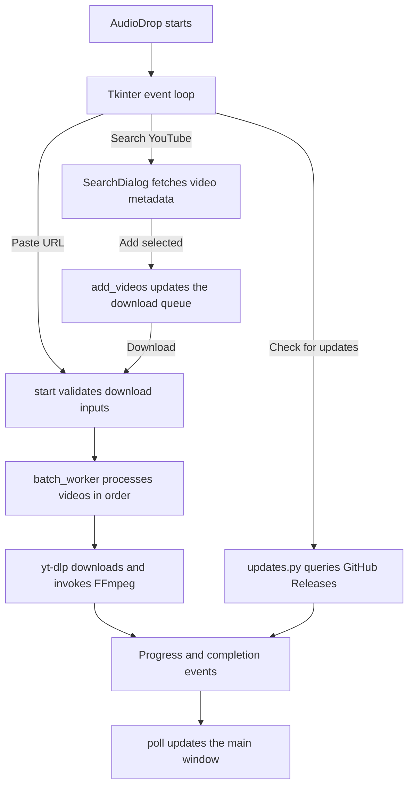

# Developing AudioDrop

## How the code flows

Start at the bottom of [`audio_drop.py`](audio_drop.py). The entry point handles `--self-test` separately. A normal launch creates `AudioDrop`, loads the saved folder and format, builds the Tkinter widgets, and starts the event loop. From there, button callbacks drive the app.



1. **Search.** `open_search()` opens `SearchDialog` in [`youtube_search.py`](youtube_search.py). Its `start_search()` starts a background worker that calls `search_videos()`. yt-dlp returns metadata for up to ten results. The dialog's own `poll()` reads the results from its event queue and fills the table. `use_selected()` passes the chosen video dictionaries back to `AudioDrop.add_videos()`, which deduplicates by URL and refreshes the visible queue.
2. **Prepare a download.** `AudioDrop.start()` takes a copy of the queued videos or uses the pasted URL when the queue is empty. It validates the inputs, checks the tools, creates the destination folder, and saves the folder and format. `download_options()` builds the yt-dlp settings. Batch filenames use the video title and ID. Single downloads can use a custom name.
3. **Download and convert.** `start()` launches `batch_worker()` on a background thread. It calls `worker()` once per video, in order. `worker()` hands the URL to yt-dlp, which downloads media and invokes the FFmpeg audio postprocessor. A failed video is recorded and the batch continues. [`runtime_paths.py`](runtime_paths.py) prefers bundled executables and falls back to PATH for source runs. Node.js is available to yt-dlp for YouTube JavaScript processing.
4. **Update the interface.** The download worker sends messages through `self.events`, a thread-safe queue. The main window's `poll()` runs on the Tkinter thread about every 100 milliseconds. It displays the current video, appends progress or errors to the log, and restores controls when the batch finishes. The search dialog uses its own event queue and polling loop.
5. **Check for app updates.** `check_updates()` starts a background request through [`updates.py`](updates.py), which compares the latest GitHub release tag against `VERSION`. The result goes through the same main-window event queue. When a newer version is available, the window offers to open GitHub Releases so the user can download and run the installer.

For a concrete trace, follow `SearchDialog.use_selected()` → `AudioDrop.add_videos()` → `AudioDrop.start()` → `batch_worker()` → `worker()` → `poll()`.

## Build and test

Use Windows x64, Python 3.12, and Inno Setup 6. Create a virtual environment, activate it, and run:

```powershell
python -m pip install -r requirements-build.txt
python bundle_tools.py
python audio_drop.py
python -m unittest discover -s tests -v
./build.ps1
```

`bundle_tools.py` downloads fixed FFmpeg and Node.js archives, checks their SHA-256 digests, and extracts the executables and notices into the ignored `vendor/` folder. No system PATH edits are made. Source execution can fall back to PATH when bundled tools are absent.

`build.ps1` builds a folder distribution, checks the packaged Node.js, FFmpeg and ffprobe with an empty PATH, converts a generated sample into all eight supported audio formats, and produces a portable ZIP and installer. Set `AUDIODROP_ISCC` to a custom Inno Setup compiler path, or pass `-SkipInstaller` for a ZIP-only development build.

The build produces `dist/AudioDrop-Setup-<version>.exe` and `dist/AudioDrop-Windows.zip`. The executable inside the app folder requires its adjacent `_internal` directory. Distribute the installer or the full portable ZIP.

The [Windows GitHub workflow](.github/workflows/windows.yml) runs the build, unit tests, and installation and uninstall checks, then uploads both distributable files. Version tags (`v*`) create draft releases. Review the installer and portable artifact before publishing a draft. When changing versions, keep `updates.py`, `installer.iss`, and the installer filename in `test_installer.ps1` in sync. Runtime updates require updating the URLs and SHA-256 digests in `bundle_tools.py`, rebuilding, and rerunning checks.

The original icon is in `assets/`; install Pillow and run `python make_icon.py` to regenerate it. Preferences are stored in `%LOCALAPPDATA%/AudioDrop/settings.json`. Downloads remain separate from installation files.
